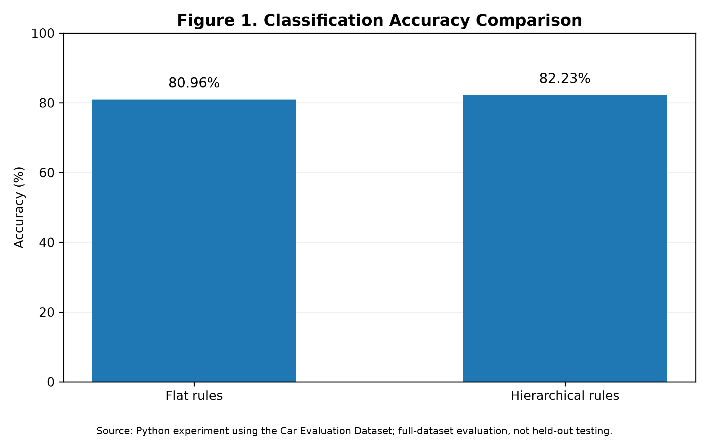
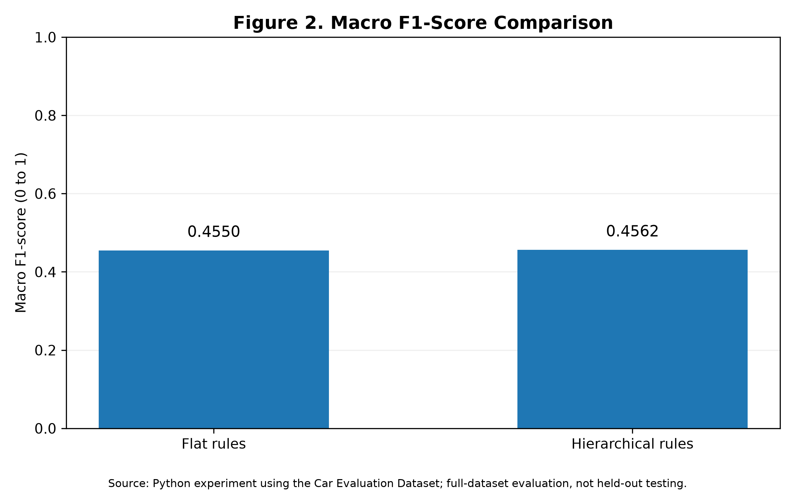
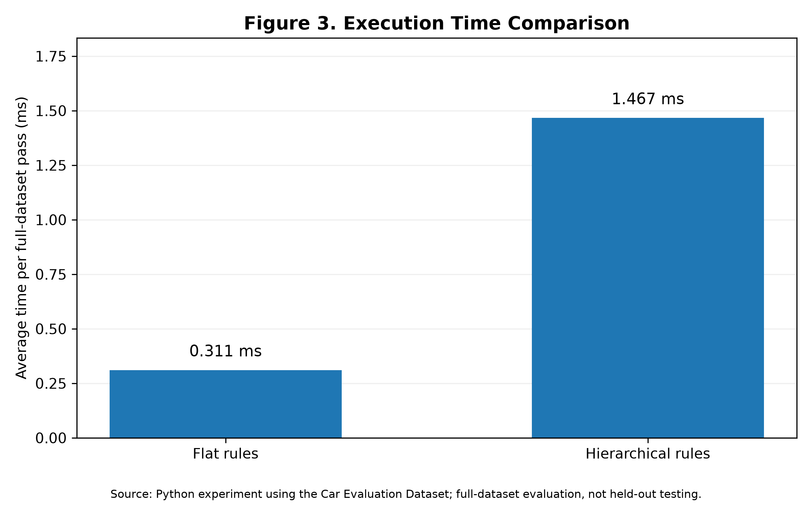

# AI Assessment 1 – Car Evaluation

## A Comparative Evaluation of Flat and Hierarchical Rule-Based Artificial Intelligence Systems

**University:** Bath Spa University  
**Programme:** BSc (Hons) Computing – Year 2  
**Module:** Artificial Intelligence (CPU5006-20P)  
**Assessment:** Assessment 1 – Rule-Based AI Experiments  
**Developer:** Long Pham (LongHP2000)  
**Programming Language:** Python  

---

## 1. Project Overview

This project investigates the performance of two rule-based artificial intelligence (AI) systems for classifying vehicle acceptability using the Car Evaluation Dataset.

The research compares a flat rule-based classifier with a hierarchical rule-based classifier. Both algorithms use manually designed IF–THEN rules rather than machine-learning models.

The experiment evaluates classification accuracy, precision, recall, F1-score and computational efficiency.

The purpose is to examine whether organising rules hierarchically produces better classification performance than using a flat sequence of decision rules.

## 2. Research Question

**How do flat and hierarchical rule-based artificial intelligence systems compare in classification accuracy, computational efficiency and interpretability when evaluating vehicle acceptability using the Car Evaluation Dataset?**

The research objectives are to:

1. Develop two distinct rule-based AI classification algorithms.
2. Evaluate both algorithms using the same dataset.
3. Compare classification accuracy, precision, recall and F1-scores.
4. Examine differences in computational efficiency.
5. Evaluate the advantages and limitations of both approaches.

## 3. Dataset Description

The project uses the Car Evaluation Dataset from the UCI Machine Learning Repository.

The dataset contains **1,728 vehicle records**, each with six input attributes and one classification label.

### Input Attributes

| Attribute | Description |
|---|---|
| Buying | Vehicle purchasing cost |
| Maintenance | Vehicle maintenance cost |
| Doors | Number of doors |
| Persons | Passenger capacity |
| Luggage boot | Luggage compartment size |
| Safety | Vehicle safety rating |

### Vehicle Classifications

| Classification | Meaning | Records |
|---|---|---:|
| unacc | Unacceptable | 1,210 |
| acc | Acceptable | 384 |
| good | Good | 69 |
| vgood | Very good | 65 |
| **Total** | | **1,728** |

The dataset is imbalanced because the majority of vehicles belong to the unacceptable category.

Consequently, accuracy alone is insufficient to assess classification performance. Macro-F1 and class-level precision and recall are also examined.

## 4. Algorithm 1 – Flat Rule-Based AI

The first algorithm uses a flat sequence of IF–THEN rules.

The system examines vehicle attributes and returns a classification when a rule's conditions are satisfied.

For example:

```python
if safety == "low":
    return "unacc"
```

The flat approach is relatively straightforward to implement and inspect.

However, its classification decisions depend on rule ordering and the completeness of its manually defined conditions.

The implementation is contained in:

`flat_rules.py`

## 5. Algorithm 2 – Hierarchical Rule-Based AI

The second algorithm uses several levels of rule-based reasoning.

### Level 1 – Price Evaluation

Combines purchasing and maintenance costs into an intermediate price assessment.

### Level 1 – Comfort Evaluation

Evaluates passenger capacity, door configuration and luggage space.

### Level 2 – Technical Evaluation

Combines safety and comfort information into a technical assessment.

### Level 3 – Final Classification

Uses the intermediate assessments to determine vehicle acceptability.

This approach makes intermediate decisions explicit, providing a structured explanation of how a classification is reached.

However, additional decision stages may increase computational cost, and the hierarchy introduces assumptions about how vehicle attributes should be combined.

The implementation is contained in:

`hierarchical_rules.py`

## 6. Experimental Methodology

Both algorithms were evaluated using the same 1,728 vehicle records.

Each classifier produced a predicted vehicle classification, which was compared with the corresponding dataset label.

The experiment calculated:

- Classification accuracy.
- Precision for each class.
- Recall for each class.
- F1-score for each class.
- Macro-F1.
- Confusion matrices.
- Execution time.

Execution time was estimated using repeated complete passes through the dataset.

The experimental comparison is implemented in:

`compare_algorithms.py`

## 7. Experimental Results

### Overall Performance

| Performance Metric | Flat Rule-Based AI | Hierarchical Rule-Based AI |
|---|---:|---:|
| Vehicles evaluated | 1,728 | 1,728 |
| Classification accuracy | 80.96% | 82.23% |
| Macro-F1 | 0.4550 | 0.4562 |
| Execution time | 0.417 ms | 1.856 ms |

The hierarchical algorithm achieved accuracy approximately 1.27 percentage points higher than the flat algorithm.

Its macro-F1 score was also marginally higher.

However, the flat algorithm was approximately 4.45 times faster in the recorded execution-time measurements.

The results therefore demonstrate a trade-off between classification performance and computational efficiency.

Neither algorithm achieved consistently strong performance across all four classification categories.

### Important Evaluation Limitation

The reported results represent performance against the complete Car Evaluation Dataset.

The rules were manually designed, and no independent held-out evaluation set was used in this initial experiment.

Consequently, these results should not be interpreted as proof of generalisation to previously unseen vehicle data.

The original dataset classifications were also derived from a hierarchical expert decision model, which is relevant when interpreting the relative suitability of hierarchical rules.

## 8. Experimental Graphs

### Figure 1 – Classification Accuracy



### Figure 2 – Macro F1-Score



### Figure 3 – Execution Time



These figures were generated automatically from the experimental results using Python and Matplotlib.

## 9. Project Files

```text
AI-Assignment-1-Car-Evaluation/
|
|-- data/
|   |-- car.data
|
|-- results/
|   |-- summary.csv
|   |-- confusion_flat.csv
|   |-- confusion_hierarchical.csv
|   |-- figure_1_accuracy.png
|   |-- figure_2_macro_f1.png
|   |-- figure_3_execution_time.png
|
|-- data_loader.py
|-- flat_rules.py
|-- hierarchical_rules.py
|-- compare_algorithms.py
|-- create_graphs.py
|
|-- README.md
```

## 10. Software Requirements

The project was developed using:

- Windows 11.
- Visual Studio Code.
- Python 3.15.
- Git and GitHub.
- Matplotlib for graph generation.

The classification algorithms and performance calculations use Python's standard library.

Matplotlib is required only for generating graphs.

### Install Matplotlib

```powershell
python -m pip install matplotlib
```

## 11. Running the Project

Open the project folder in Visual Studio Code.

Open the integrated terminal and execute the following commands.

### Step 1 – Load the Dataset

```powershell
python data_loader.py
```

### Step 2 – Run Algorithm 1

```powershell
python flat_rules.py
```

### Step 3 – Run Algorithm 2

```powershell
python hierarchical_rules.py
```

### Step 4 – Compare Both Algorithms

```powershell
python compare_algorithms.py
```

This command evaluates both classifiers and saves CSV results in the `results` folder.

### Step 5 – Generate Comparison Graphs

```powershell
python create_graphs.py
```

This command creates the three comparison graphs in PNG format.

## 12. Research Limitations

Several limitations should be considered when interpreting the findings.

First, both algorithms use manually designed rules and do not learn automatically from data.

Second, the Car Evaluation Dataset contains substantially more unacceptable vehicles than vehicles belonging to the other categories.

Third, classification performance was evaluated on the complete dataset rather than a separately reserved test set.

Fourth, execution-time measurements may vary according to hardware, operating system and background processes.

Finally, the hierarchical algorithm provides visible intermediate decisions, but improved human interpretability has not been established through user testing.

Further research could investigate revised rule conditions, independent testing and systematic evaluation of explanation quality.

## 13. AI Assistance Declaration

Generative AI assistance was used during the development of Python code, project documentation and the experimental workflow.

The generated code and explanations require review, testing and critical evaluation before academic submission.

The scientific research paper will separately acknowledge the use of AI tools in accordance with the university's assessment requirements.

## 14. Dataset Reference

Bohanec, M. (1997) *Car Evaluation* [Dataset]. UCI Machine Learning Repository. DOI: 10.24432/C5JP48.

The dataset and its original documentation are credited to the UCI Machine Learning Repository.

---

**Project:** Artificial Intelligence Assessment 1  
**Institution:** Bath Spa University  
**Academic Year:** 2026–2027